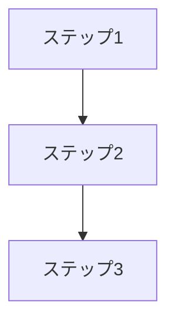

# 記事で使う図（mermaid）

記事で使う図の案をここに置き、執筆時に本文へ取り込みます。図はAIエージェントが `REF-xx` / `NOTE-xx` に基づいて作成した叩き台であり、検証結果・実際の体験に合わせて調整します。

## 運用ルール
- 図1件につき見出し1つ。何に基づいて作った図か（`[REF-xx]` / `[NOTE-xx]`）を見出しに明記します。
- 「図の意図」は必須です。この図で何を伝えるか、本文のどの主張と対応するかを書きます。図の意図が書けない図は本文にも入れません。
- 使わないことにした図も削除せず、見出し直下に `**→ 不使用決定（日付）**: <理由と、記事では何に置き換えたか>` を書いて経緯として残します。

## 図①: （図の名前）（[REF-xx] に基づく）

使用箇所: （章・節と用途。例: 2.1「デモの全体像」で全体の流れを見せる用）

- 図の意図: （この図で何を伝えるか。本文のどの主張に対応するか）
- 注意: （適用範囲の限定や、書き分けの注意があれば）
